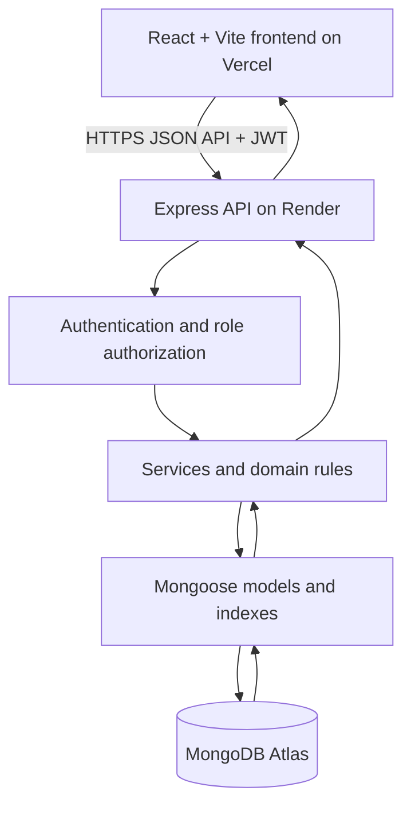

# WardLine — Quarantine & Treatment Facility App

**A full-stack prototype for the Factwise Technical Product Manager assessment.** WardLine helps a quarantine/treatment centre coordinate daily temperature checks, doctor rounds, discharge processing, bed occupancy, and patient outcomes.

> **Prototype for evaluation. Uses simulated data. Not for clinical use.** Do not enter real patient, health, or personally identifiable information. The configured fever thresholds and operational rules are demo assumptions that require clinical validation before real use.

## 1. What problem does WardLine solve?

The centre currently uses paper journals and verbal handoffs. Staff cannot reliably tell who has had a temperature recorded or a doctor visit, discharge-eligible patients can remain in beds unnecessarily, and management cannot compare recorded outcomes with the stated 15% mortality / 85% success benchmark.

WardLine gives staff shared, role-specific queues backed by a server and database:

- **Nurse:** see pending temperature checks, record today's reading, correct a reading with a reason, and admit a patient when a room is available.
- **Doctor:** review readings and history, see patients ready for rounds, log one primary visit per day, approve/revoke a discharge, and record a death.
- **Admin:** manage admissions and room allocation, review the shared discharge queue, and complete checkout after approval.
- **Director:** monitor occupancy, daily workflow completion, discharge delays, mortality and success rate, and the alert state.

The main workflow is: **admission → temperature → doctor visit → eligibility calculation → doctor approval → admin checkout**. A patient becomes eligible after the configured number of consecutive fever-free facility dates; missing readings break the streak. Eligibility is displayed automatically, but the prototype retains a separate doctor approval step as an accountability checkpoint.

## 2. Architecture overview



MongoDB is the system of record. This is not a frontend-only mock-up: a nurse's saved reading is stored centrally and becomes available to a doctor/admin in another session after refresh/polling.

### Stack

| Layer | Technology |
|---|---|
| Frontend | React, Vite, JavaScript ES modules, React Router, Tailwind CSS |
| Native UI state | React Context, `useReducer`, `useState`, `useEffect` — no Zustand/Redux |
| API | Node.js, Express, JavaScript ES modules |
| Database | MongoDB Atlas with Mongoose schemas and indexes |
| Validation | Zod (usable from JavaScript) + Mongoose validation |
| Authentication for assessment | Demo personas + signed JWT; not real identity verification |
| Charts and UI | Recharts, Radix UI primitives, lucide-react, Sonner |
| Tests | Vitest, React Testing Library, Supertest; Playwright smoke checks recommended |
| Frontend hosting | Vercel |
| Backend hosting | Render |

### Important design choices

1. The backend enforces permissions and business rules; frontend route guards and hidden buttons are only user-experience aids.
2. Eligibility, fever classification, occupancy, task status, and mortality metrics are calculated by backend services. React displays the API's results instead of maintaining a separate clinical rules engine.
3. Multi-document operations (for example discharge checkout and freeing a room) use MongoDB transactions. Unique indexes prevent duplicate active daily temperatures and duplicate primary visits under concurrent requests.
4. Shared worklists refresh after mutations, every 15–30 seconds, and when a browser tab regains focus. Push updates/WebSockets are not required for the assessment MVP.
5. Demo login and demo reset/time-travel actions are permitted only while demo mode is enabled. Disable them before any real-world use.

## 3. Primary screens

- **Dashboard:** occupied/free rooms, temperature and visit completion, patients awaiting discharge action, and the mortality/success indicator.
- **Nurse worklist:** patients pending a temperature today, completed readings, fever/critical flags, duplicate prevention and correction history.
- **Doctor rounds:** critical readings first, discharge-eligible patients, ready-to-visit patients, and patients awaiting a temperature.
- **Visit page:** patient history, today's temperature, fever-free streak, visit notes and clinical status, plus explicit discharge/death actions where allowed.
- **Bed map:** 74 room tiles grouped by ward, with available/occupied/eligible/approved states.
- **Discharge queue:** eligible patients waiting for approval and approved patients waiting for admin checkout.
- **Patient list/profile:** admission details, temperature chart/history, visits, discharge history and audit details.
- **Director analytics:** mortality and success rate, sample size, occupancy, daily compliance, discharge delays and average length of stay.
- **Audit log:** who performed each important change, when it occurred, and a readable summary.

## 4. Roles and permissions

| Action | Nurse | Doctor | Admin | Director |
|---|:---:|:---:|:---:|:---:|
| View facility overview, rooms and patient profiles | Yes | Yes | Yes | Yes |
| Admit patient / assign available room | Yes | No | Yes | No |
| Record today's temperature | Yes | Only override if required and reason supplied | No | No |
| Correct today's reading with reason | Yes | No | No | No |
| Log doctor visit / add visit addendum | No | Yes | No | No |
| Approve or revoke discharge | No | Yes | No | No |
| Complete discharge checkout | No | No | Yes | No |
| Record patient death | No | Yes | No | No |
| View full analytics / edit settings | No | No | No | Yes |
| View audit log | No | No | Yes | Yes |

These are enforced by backend middleware/services, not only by the UI. Director/other-role access to selected read-only screens follows the permission matrix in [`architecture.md`](./architecture.md).

## 5. Core business rules

- **Capacity:** the prototype has 74 rooms. Admission is blocked when all rooms are occupied; checkout or death releases a room as part of the same transaction.
- **Temperature:** one active reading per patient per facility date. Corrections require a reason and preserve the old reading. No back-dating/future-dating in P0.
- **Threshold assumptions:** the default fever threshold is 38.0 °C and critical threshold is 40.0 °C. These are configurable prototype defaults, not medical advice; validate them with the head doctor.
- **Doctor visit:** a primary visit requires a same-day temperature reading first. A second attempt opens the existing visit/addendum flow rather than creating a duplicate primary visit.
- **Discharge eligibility:** the default is three consecutive facility dates with an active non-fever reading on every date. A missing day or fever breaks the streak; stale readings cannot produce current eligibility.
- **Discharge processing:** eligibility is surfaced automatically. With the default setting, a doctor must approve before admin can complete checkout. A fever or correction that makes the patient ineligible revokes the approval.
- **Mortality:** `deaths / (deaths + discharges)` among closed cases; active cases are excluded because their outcome is unknown. A minimum sample is required before raising an alert. The 12% warning level and minimum sample size of 20 are prototype assumptions.
- **Audit:** important writes record the actor, role, timestamp, patient/entity, action and summary. Audit events are append-only in the UI.
- **Authorization:** API calls without a valid token receive 401; calls from a role without permission receive 403; duplicate/racing writes receive a conflict response.

The phrase “three full days without fever” needs a shared operational definition. This prototype interprets it as three consecutive facility dates, each with an active afebrile reading. Confirm this rule, the facility timezone, and the doctor-approval checkpoint with the head doctor before real use.

## 6. Repository structure

```text
wardline/
  README.md
  architecture.md
  client/                # Vite/React app; deploy to Vercel
    .env.example
    package.json
    vercel.json
    src/
      app/
      state/              # AuthContext + AppDataContext
      lib/api.js
      features/
      components/
      styles/
  server/                # Express API; deploy to Render
    .env.example
    package.json
    src/
      app.js
      index.js
      config/
      middleware/
      routes/
      controllers/
      services/
      domain/             # pure JavaScript rules
      models/             # Mongoose schemas/indexes
      validators/
      seed/
      tests/
```

The architecture specification is the source of truth for the detailed route list, model invariants, rule IDs, wireframes, work packages and acceptance criteria.

## 7. Run locally

### Prerequisites

- Node.js LTS and npm.
- A MongoDB Atlas database. Use a dedicated **demo** database; do not point the app at any database that contains real user/patient data.
- Git and a modern browser.

### 7.1 Start the backend

```bash
cd server
npm install
```

Create `server/.env` from `.env.example` and fill in the Atlas URI and a long random JWT secret. Example values for local development:

```dotenv
NODE_ENV=development
PORT=4000
MONGODB_URI=mongodb+srv://<user>:<password>@<cluster>/<demo-db>?retryWrites=true&w=majority
JWT_SECRET=<long-random-secret>
CLIENT_ORIGIN=http://localhost:5173
FACILITY_TIMEZONE=Asia/Kolkata
DEMO_MODE=true
DEMO_TOOLS_ENABLED=true
JWT_EXPIRES_IN=4h
```

Then run:

```bash
npm run seed       # populate the dedicated demo database with fictional data
npm run dev        # start Express API on port 4000
```

The server should expose `GET http://localhost:4000/api/health`. The health response must not reveal secrets or database details. MongoDB transactions require a replica-set deployment; use an Atlas cluster that supports them.

### 7.2 Start the frontend

In a second terminal:

```bash
cd client
npm install
```

Create `client/.env.local`:

```dotenv
VITE_API_BASE_URL=http://localhost:4000/api
```

Run:

```bash
npm run dev
```

Vite typically serves the frontend at `http://localhost:5173`. Open the app and choose a seeded demo persona. The names/roles displayed by the demo login come from the seeded `users` collection; no shared production credentials are required.

### 7.3 Tests

Run the scripts present in each package:

```bash
# Backend domain and integration tests
cd server
npm test
npm run test:integration

# Frontend tests
cd ../client
npm test
```

The integration-test configuration must use an isolated test database and must never reset the shared demo database. If a script name differs slightly in the implemented package manifest, use that package's `npm run` output as the source of truth.

## 8. Environment configuration

### Backend on Render

Required variables:

- `NODE_ENV=production`
- `PORT` (Render provides this; the server must listen on `process.env.PORT`)
- `MONGODB_URI`
- `JWT_SECRET`
- `CLIENT_ORIGIN` (the exact deployed Vercel origin)
- `FACILITY_TIMEZONE=Asia/Kolkata`
- `DEMO_MODE=true` for the assessment demo only
- `DEMO_TOOLS_ENABLED=true` for the assessment demo only
- `JWT_EXPIRES_IN=4h`

Never commit real environment files or put `MONGODB_URI` / `JWT_SECRET` into a `VITE_*` variable. Restrict Atlas access and use a least-privilege database user.

### Frontend on Vercel

- `VITE_API_BASE_URL=https://<your-render-service>.onrender.com/api`

The Vercel environment is public to the browser bundle. It may contain the API URL but no secrets.

## 9. Deploy

### 9.1 MongoDB Atlas

1. Create a dedicated demo cluster/database and application user.
2. Configure network access using the provider's recommended approach for the Render service.
3. Put the connection string into the Render `MONGODB_URI` variable.
4. Confirm the cluster supports transactions and that model indexes are created before seeding.

### 9.2 Render backend

1. Create a Node web service from the repository.
2. Set the root directory to `server`.
3. Set build command to `npm install` and start command to `npm start`.
4. Set the health check path to `/api/health`.
5. Add environment variables listed above; set `CLIENT_ORIGIN` to the final Vercel origin.
6. Seed the dedicated database once using the documented seed command or a safe one-off shell command. Do not make server startup drop/reseed a database automatically.
7. Verify health, demo login, CORS, and one write/read round trip.

### 9.3 Vercel frontend

1. Import the repository into Vercel.
2. Set root directory to `client` and framework preset to Vite.
3. Set build command to `npm run build` and output directory to `dist`.
4. Configure `VITE_API_BASE_URL` with the Render URL ending in `/api`.
5. Add `client/vercel.json` with the SPA rewrite below so deep links survive a page refresh:

```json
{
  "rewrites": [
    { "source": "/(.*)", "destination": "/index.html" }
  ]
}
```

6. Redeploy after environment updates. Update Render's `CLIENT_ORIGIN` to match the exact Vercel origin.
7. Test using separate browser sessions to verify that readings, visits, discharge actions, and dashboard values are shared through MongoDB.

**Live links:** add them here only after deployment has succeeded.

- Frontend: _Not deployed yet_
- Backend health: _Not deployed yet_

## 10. Six-minute demonstration script

1. **Nurse:** open the temperature worklist, record 38.4 °C for a pending patient, and verify the row moves to Done and counters update. Try to record again to show duplicate protection. Correct the reading with a reason and show the audit/history.
2. **Capacity:** attempt admission at 74/74 and show that the app blocks it. Switch to Admin, complete a previously approved discharge, confirm the room is freed, then admit a new fictional patient into it.
3. **Doctor:** use a separate browser session or switch persona. Verify the nurse's temperature is visible. Open a Ready to visit patient, record clinical status/notes, then demonstrate that a second primary visit is blocked in favour of an addendum.
4. **Eligibility:** open a patient with a 3-of-3 fever-free streak and inspect the dates/readings that support eligibility. Approve discharge as Doctor.
5. **Admin:** open the queue and complete checkout. Verify room availability and dashboard counters.
6. **Director:** check the seeded mortality dashboard (43 discharged, 7 deceased = 14.0% across 50 closed cases, in WARNING with the default thresholds). As Doctor, record a death using a seeded eligible demo case not already closed; analytics should update to 8/51 = 15.7% and BREACH. Confirm the audit event.
7. Reset demo data only if you have confirmed that resetting affects every session using this shared demo database.

The demo seed and all displayed patient names/clinical data must be fictional. If the seeded data or thresholds are changed, explain the current counts rather than presenting the example counts as hard-coded facts.

## 11. Known limitations and out of scope

- Demo personas are not a real authentication or identity-verification system.
- No medication management, treatment recommendation, SMS notification, waiting list, hospital-system integration or multi-facility support in P0.
- Shared worklists use polling/refresh, not WebSocket-based instant updates.
- Analytics use the defined closed-case denominator and configured alert thresholds; confirm the methodology with the centre before interpreting real-world performance.
- Temperature and “three full days” definitions need clinical sign-off. Missing observations are not treated as evidence of no fever.
- The demo's seeded scenarios and simulated clock are intended for demonstration/testing only.
- Do not use this prototype for patient care or store real patient data.

## 12. Assessment mapping

| Assessment question | WardLine response |
|---|---|
| Q1 — user types and features | Four role personas with a permission matrix: Nurse, Doctor, Admin, Director |
| Q2 — functional prototype | Role-based screens, real API, MongoDB persistence, temperature/visit/discharge workflow, outcome dashboard, hosted frontend/backend |
| Q3 — logical constraints | Rule IDs for admission, temperature, daily tasks, visit prerequisites, discharge eligibility, death, mortality, authorization, and audit |
| Q4 — sprint selection | Answer separately in the assessment PDF; it is a prioritization calculation, not an app feature |

## 13. Project status

This README is the setup/deployment specification. Replace the placeholder deployment links with the actual Vercel and Render URLs after deployment, and validate all demo steps against the deployed stack before submission.
