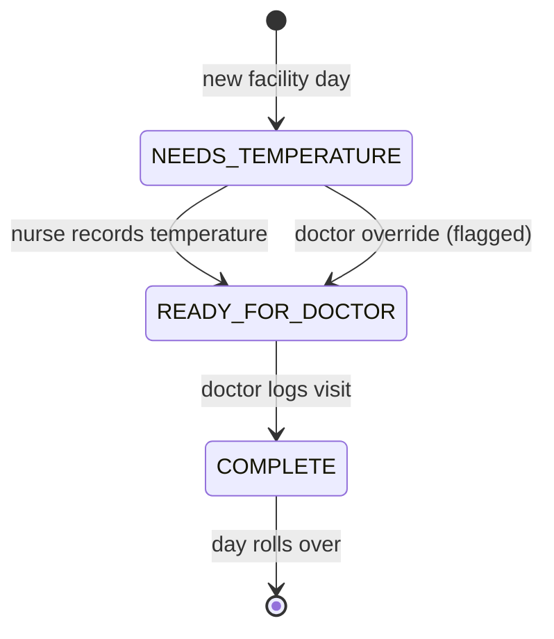
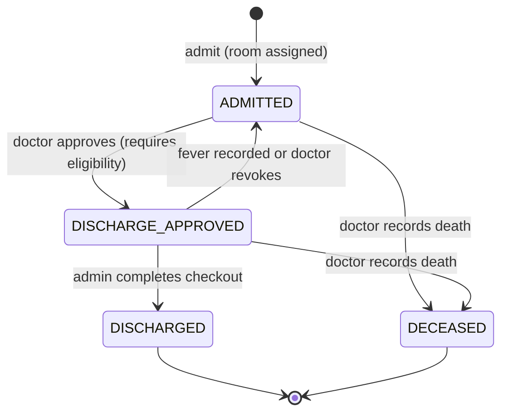
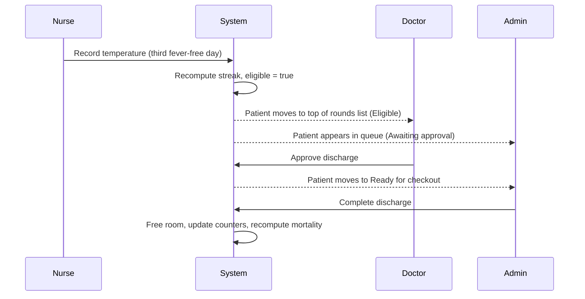

# Quarantine and Treatment Facility App: Prototype Architecture

Working name: **WardLine**
Document status: v2.0, full-stack architecture and source of truth for implementation
Audience: product, frontend, backend, QA, and reviewers building the Factwise TPM assessment prototype

---

## 0. How to use this document

1. Read sections 1 to 6 fully before writing code. They define scope, roles, the domain model, and the business rules. Sections 7 onward define how to build it.
2. Business rules carry stable IDs (for example `TMP-2`, `DIS-3`). Reference these IDs in code comments, test names, and commit messages. If you change a rule, change it here first.
3. The backend is authoritative for clinical/business rules, permissions, data integrity, and computed patient status. Keep these rules in `server/src/domain/` as plain JavaScript modules with no Express or Mongoose imports. The frontend renders API results and must not re-implement eligibility or permission rules.
4. Work is divided into work packages in section 15. Build and verify the backend/domain/data model before wiring the screens. Each package lists owned files, dependencies, and acceptance criteria.
5. Anything marked **P0** is required for the assessment demo. **P1** is valuable if time allows. **P2** is explicitly deferred and should only appear in the product notes, not in code.
6. If something is ambiguous, apply the default in section 16 (Decisions and assumptions log) and append a line to that log. Do not stop to ask.

---

## 1. Product context

### 1.1 Problem in one paragraph

A virus quarantine centre has 74 rooms, all occupied. Nurses must measure every patient's temperature once per day; a doctor must then visit every patient once per day, after the temperature exists. Today this runs on paper journals, so nobody knows who has been measured or visited, readings are duplicated or missed, doctors visit before temperatures exist, discharges are communicated late (patients stay 1 to 2 extra days, blocking beds), and there is no measurement of the mortality rate against the 85% success benchmark (15% expected mortality).

### 1.2 Goals of the prototype

| # | Goal | Maps to problem |
|---|------|-----------------|
| G1 | Give every nurse a live, shared checklist of who still needs a temperature today | Duplicate or missed readings |
| G2 | Give every doctor a live list showing which patients are ready to visit (temperature present) and which are done | Doctors visiting too early or erratically |
| G3 | Compute discharge eligibility automatically from the 3-day no-fever rule and route it to doctor approval and then admin without verbal handoff | Late discharges, blocked beds |
| G4 | Show real-time bed occupancy and free beds the moment one is released | Underused capacity |
| G5 | Compute mortality and success rate against the 15% / 85% benchmark and alert on breach | No quality tracking |

### 1.3 Scope

**In scope (P0):** role-based login (demo), patient admission, daily temperature recording, doctor visit logging, discharge eligibility, discharge approval and checkout, death recording, bed map, mortality dashboard with alert, audit log, demo tools (simulated clock, reset, auto-fill).

**P1:** settings screen for editing thresholds, advanced patient search/filter combinations, CSV export of patient chart, Fahrenheit display toggle, printable discharge summary. Basic patient search/filter and read-only settings are P0.

**P2 (not built):** production-grade authentication/identity management, waiting list, shift scheduling, medication management, notifications via SMS, multi-facility support, integration with hospital systems. Shared multi-device data is P0 through the API and MongoDB; real-time push (WebSockets/SSE) is P1.

### 1.4 Non-goals

This is a prototype, not a clinical system. It is not validated for real patient care and carries no compliance claims. The UI footer must state: "Prototype for evaluation. Uses simulated data."

---

## 2. Roles and permissions (feeds Q1)

### 2.1 Roles

| Role | Who | Primary job in the app |
|------|-----|------------------------|
| `NURSE` | Floor nurse | Admit patients, record daily temperature |
| `DOCTOR` | Treating doctor | Review chart, log daily visit, approve discharge, record death |
| `ADMIN` | Admin staff | Manage beds and admissions, complete discharge checkout |
| `DIRECTOR` | Head doctor / centre management | Monitor quality, occupancy, compliance, and the mortality alert; edit thresholds |

A user has exactly one role. The demo login lets the evaluator pick a named user per role.

### 2.2 Permission matrix

Legend: **C** create, **R** read, **U** update, **X** execute action, **-** no access.

| Capability | NURSE | DOCTOR | ADMIN | DIRECTOR |
|------------|:-----:|:------:|:-----:|:--------:|
| View facility overview (occupancy, task progress) | R | R | R | R |
| View bed map | R | R | R | R |
| View patient list and patient profile | R | R | R | R |
| Admit patient (create record, assign room) | C | - | C | - |
| Edit patient demographics | U | - | U | - |
| Record today's temperature | C | - | - | - |
| Correct today's temperature (with reason) | U | - | - | - |
| View nurse worklist (pending temperatures) | R | - | - | R |
| View doctor rounds list | - | R | - | R |
| Log doctor visit | - | C | - | - |
| Override: record temperature as doctor (flagged) | - | X | - | - |
| Approve discharge | - | X | - | - |
| Revoke discharge approval | - | X | - | - |
| Complete discharge checkout (free room) | - | - | X | - |
| Record patient death | - | X | - | - |
| View discharge queue | - | R | R | R |
| View mortality dashboard and alert | R (banner only) | R (banner only) | R (banner only) | R |
| View full analytics (trends, LOS, compliance) | - | - | - | R |
| Edit settings and thresholds | - | - | - | U |
| View audit log | - | - | R | R |
| Demo tools (clock, reset, auto-fill) | X | X | X | X |

Notes:
- Nurses can admit because the assessment explicitly expects "a nurse should be able to add and record a patient's temperature".
- Only doctors decide clinical outcomes (approve discharge, record death). Admin cannot approve their own discharges; they only execute logistics.
- The alert banner is visible to all roles so staff see the quality status; the detailed analytics page is Director only.

---

## 3. Technology choices

The product is a small but genuinely multi-user full-stack application. The API and database are the source of truth: a nurse's saved temperature must be visible to a doctor/admin on another device, and role enforcement must not depend on hiding frontend buttons.

| Concern | Choice | Reason |
|---------|--------|--------|
| Frontend build | Vite 5+ | Fast build and simple static deployment |
| Frontend language | JavaScript (ES modules) | User preference; avoid TypeScript tooling and type declarations |
| UI | React 18+ | Component-based screens and forms |
| Routing | `react-router-dom` v6 (`createBrowserRouter`) | Role-aware routes and deep links |
| Styling | Tailwind CSS 3.4 with CSS variables | Fast, consistent design system |
| Accessible primitives | Radix UI primitives wrapped locally | Keyboard-accessible dialogs, tabs, select and popover |
| Frontend state | React Context + `useReducer` for shared session/UI/API-cache state; `useState` for local forms | Native React state; no Zustand or other global state library |
| API client | Native `fetch` wrapped in `client/src/lib/api.js` | Centralized token, JSON, error, and timeout handling; no extra request-state library in P0 |
| Backend runtime | Node.js LTS, JavaScript ES modules | Same language across frontend/backend |
| Backend framework | Express | Small REST API and middleware ecosystem |
| Database | MongoDB Atlas | Persistent shared data across sessions and devices |
| ODM | Mongoose | Schema validation, indexes, and transactional model operations |
| Authentication (prototype) | Demo-user login + signed JWT | Demonstrates role-specific workflows without a third-party identity provider |
| Validation | Zod (JavaScript usage) at API/form boundaries plus Mongoose validation | Clear input errors; usable with JavaScript without TypeScript |
| Date handling | `date-fns` plus `date-fns-tz` | Facility-local day boundaries and timezone-aware calculations |
| Charts | Recharts | Temperature history and mortality reporting |
| Icons | `lucide-react` | Consistent icon set |
| Toasts | `sonner` | Mutation feedback |
| IDs | MongoDB ObjectIds for persisted documents; readable MRNs generated by the API | Database-native references and stable patient-facing identifiers |
| Fonts | `@fontsource` packages | Self-hosted fonts and fewer external dependencies |
| Backend tests | Vitest + Supertest | Domain tests and HTTP/API integration tests |
| Frontend tests | Vitest + React Testing Library | Workflow and component tests |
| Browser smoke test | Playwright (P0 for demo path if time permits; otherwise final QA checklist) | End-to-end role/workflow verification |
| Lint/format | ESLint + Prettier | Consistency |
| Frontend hosting | Vercel (static Vite site) | Straightforward assessment link and SPA rewrites |
| Backend hosting | Render web service | Hosts Express API independently of the static frontend |
| Database hosting | MongoDB Atlas | Managed database; not tied to Render's ephemeral filesystem |

### 3.1 Architectural choices and boundaries

- **No Zustand, Redux, or other global-state library.** `AuthContext` owns the active demo session; `AppDataContext` uses `useReducer` for loaded API data and loading/error states; individual forms and dialogs use `useState`.
- **Do not use browser `localStorage` as the system of record.** Persist patients, rooms, readings, visits, discharge records, deaths, settings, and audit events in MongoDB. `sessionStorage` may hold the prototype JWT for the current browser session only.
- **The browser is not trusted.** Hiding a button is a UX detail, not authorization. Every protected endpoint performs JWT authentication and server-side role/permission checks, and every mutation is validated on the server.
- **Backend-derived values are authoritative.** The API returns worklist status, eligibility, occupancy, overdue flags, and outcome metrics. The UI may sort/filter returned rows for display, but must not calculate clinical eligibility or mortality on its own.
- **No real patient data.** This is an evaluation prototype with fictional seeded data. Do not enter actual personally identifiable or clinical information.
- **Production hardening is out of scope.** Demo login, public demo personas, and demo controls are acceptable only while the app is explicitly in evaluation mode. They must be disabled before any real-world use.

### 3.2 Deployment topology

`client/` is deployed on Vercel as a static site. `server/` is deployed as a Node/Express web service on Render. Both connect over HTTPS; the API connects to MongoDB Atlas. The Vercel origin is explicitly allow-listed by the backend CORS configuration. Render's filesystem is not used for persistence.

The prototype provides real shared persistence and multi-device data access, but it does not claim to be a clinical-grade production system. The footer and README must state this clearly.

## 4. Repository structure

Use a simple repository with separately deployable frontend and backend folders. Plain `.js` files are used throughout; there are no `.ts`, `.tsx`, or `tsconfig.json` files.

```text
wardline/
  README.md
  architecture.md
  package.json                 # optional root convenience scripts
  client/                      # Vite + React; deployed to Vercel
    package.json
    index.html
    vite.config.js
    tailwind.config.js
    postcss.config.js
    vercel.json                # SPA rewrite
    .env.example
    src/
      main.jsx
      app/
        router.jsx
        AppShell.jsx
        RequireRole.jsx         # UX guard only; backend still enforces permissions
      state/
        AuthContext.jsx
        AppDataContext.jsx      # useReducer; server remains source of truth
      lib/
        api.js                  # fetch wrapper, JWT header, structured errors
        format.js
        cn.js
      features/
        auth/
        overview/
        nurse/
        doctor/
        admin/
        director/
        patients/
        audit/
        demo/
      components/
        ui/
        domain/
      styles/
        tokens.css
        index.css
      tests/
  server/                       # Express API; deployed to Render
    package.json
    .env.example
    src/
      app.js                    # Express app, middleware and routes
      index.js                  # server startup and graceful shutdown
      config/
        env.js
        database.js
        facility.js
      middleware/
        authenticate.js
        authorize.js
        validate.js
        errorHandler.js
        requestId.js
      routes/
        auth.routes.js
        patient.routes.js
        room.routes.js
        temperature.routes.js
        visit.routes.js
        discharge.routes.js
        death.routes.js
        dashboard.routes.js
        settings.routes.js
        audit.routes.js
        demo.routes.js
      controllers/               # HTTP input/output only
      services/                  # transactions and orchestration
      domain/                    # pure JavaScript business rules
        temperature.js
        tasks.js
        eligibility.js
        metrics.js
        permissions.js
        errors.js
        dates.js
      models/                    # Mongoose schemas and indexes
        User.js
        Patient.js
        Room.js
        TemperatureReading.js
        DoctorVisit.js
        DischargeRecord.js
        DeathRecord.js
        FacilitySettings.js
        AuditEvent.js
      validators/                # Zod schemas, JavaScript
      seed/
        seed.js
        names.js
        prng.js
      tests/
        domain/
        integration/
  docs/
    assessment-notes.md          # optional, no real patient data
```

### 4.1 Dependency rules

- `server/src/domain/` is plain JavaScript and imports neither Express nor Mongoose. It receives data and settings as arguments and returns deterministic results.
- Controllers parse HTTP requests and send HTTP responses; business rules and multi-document transactions belong in services/domain modules, not controllers.
- Mongoose models define persistence shape and indexes. Services use models to load/commit data and invoke domain functions.
- Frontend feature screens call `client/src/lib/api.js`. They do not access MongoDB or import backend files.
- `AuthContext` and `AppDataContext` are infrastructure/state boundaries, not a place for clinical rules.
- Presentational components do not call APIs directly. Feature pages dispatch context actions or call the API helper, then refresh/update the shared API state.
- Never store the MongoDB URI or JWT signing secret in Vercel `VITE_*` variables. Frontend environment variables are public by definition.

## 5. Domain model and MongoDB persistence

Persist each major entity in its own MongoDB collection. The API returns JSON representations to the client; the exact Mongo `_id` may be serialized as `id` for UI convenience. Use Mongoose schemas for shape validation and database indexes for invariants that must hold under concurrent requests.

### 5.1 Collections

| Collection | Important fields | Notes |
|------------|------------------|-------|
| `users` | `name`, `role`, `isActive`, `demoPersona` | Roles: `NURSE`, `DOCTOR`, `ADMIN`, `DIRECTOR`. Seed fictional demo users. Do not store plain-text passwords. In demo mode, login issues a short-lived signed token for a known seed user. |
| `rooms` | `number`, `ward`, `status`, `patientId` | Exactly 74 rooms in the prototype; unique index on `number`. `status` is `AVAILABLE` or `OCCUPIED`. |
| `patients` | `mrn`, demographics, contacts, `admittedOn`, `admittedAt`, `admittedBy`, `roomId`, `status`, `closedOn`, `closedAt`, `notes` | Status is `ADMITTED`, `DISCHARGE_APPROVED`, `DISCHARGED`, or `DECEASED`. `mrn` is generated by the API and immutable. A closed patient has no current room. |
| `temperatureReadings` | `patientId`, `date`, `recordedAt`, `valueC`, `recordedBy`, `recordedByRole`, `isFever`, `isCritical`, `isActive`, `supersededBy`, `correctionReason` | Retain corrected readings for audit/history; only one active reading per patient/facility-date. `date` uses `YYYY-MM-DD` in the facility timezone; `recordedAt` is an instant. |
| `doctorVisits` | `patientId`, `date`, `visitedAt`, `doctorId`, `temperatureReadingId`, `clinicalStatus`, `notes`, `treatmentPlan`, `addenda[]` | One primary visit per patient per facility date. Addenda are append-only. |
| `dischargeRecords` | `patientId`, `eligibleOn`, `approvedAt`, `approvedBy`, `revokedAt`, `revokedReason`, `completedAt`, `completedBy`, `history[]` | One record per eligibility cycle; `history[]` and audit events preserve approval/revocation/checkout changes. Do not overwrite the previous cycle when the patient later becomes eligible again. |
| `deathRecords` | `patientId`, `occurredAt`, `recordedAt`, `recordedBy`, `causeNote` | One final death outcome per patient in this prototype. Death recording closes the patient and frees the room in the same transaction. |
| `facilitySettings` | `capacity`, `feverThresholdC`, `criticalThresholdC`, `requiredFeverFreeDays`, `mortalityBenchmark`, `mortalityWarningRatio`, `minClosedCasesForAlert`, `requireDoctorApproval`, `approvedNotDischargedSlaHours`, `facilityTimezone`, optional `demoClockNow` | Treat the fever threshold and alert parameters as prototype defaults requiring facility validation, not clinical guidance. One settings document per facility. |
| `auditEvents` | `at`, `actorId`, `actorRole`, `action`, `entity`, `entityId`, `patientId`, `summary`, `meta` | Append-only from the UI/API. No edit/delete endpoint. Reset is restricted to demo mode and writes an audit entry after reseeding. |

### 5.2 IDs, dates and timestamps

- MongoDB ObjectIds are the persistent IDs for users, patients, readings, visits, rooms, and records. Patient MRNs are human-readable sequential values such as `QF-000123`, generated server-side.
- A facility date is a string in `YYYY-MM-DD`, calculated on the server using `FACILITY_TIMEZONE`. Never trust a date submitted by the browser for “today.”
- Instants such as `recordedAt`, `visitedAt`, and `closedAt` are stored as BSON Date values (serialized as ISO-8601 strings in API responses).
- Every backend service gets time from one clock abstraction. The demo clock can be advanced only when demo tools are enabled; normal mode uses the actual current instant.
- Avoid date arithmetic using locale-dependent browser parsing. Use `date-fns` / `date-fns-tz` in the backend.

### 5.3 Integrity invariants and database indexes

1. A room has at most one patient; a patient with status `ADMITTED` or `DISCHARGE_APPROVED` has exactly one room; closed patients have `roomId = null`.
2. Occupied rooms never exceed configured capacity (74 in the assessment prototype).
3. Create a unique compound index on `temperatureReadings: { patientId: 1, date: 1 }` with a partial filter for `isActive: true`. Corrections set the former row inactive and create a replacement inside a transaction.
4. Create a unique compound index on `doctorVisits: { patientId: 1, date: 1 }`.
5. A visit requires an active reading for the same patient/date, and `visitedAt` must be later than that reading's `recordedAt`.
6. A discharge checkout requires an active, unrevoked approval when `requireDoctorApproval` is true.
7. Closed patients cannot receive new readings, visits, discharge approvals, or further lifecycle transitions except a correction process that is explicitly added later.
8. A patient can occupy only one room at a time. Enforce this in service-level transactions, and add an appropriate unique/partial index if the selected model stores active occupancy directly on patient documents. Add a unique index on `deathRecords.patientId` and an index on `dischargeRecords: { patientId: 1, eligibleOn: 1 }` so a patient can have a separate discharge record for each eligibility cycle.
9. Every mutation records an audit event in the same transaction where feasible. If audit persistence fails, fail the mutation rather than silently committing an unaudited clinical/administrative change.

MongoDB transactions require a replica-set deployment. MongoDB Atlas provides this for normal clusters; verify the selected cluster tier and connection string before implementation. Do not assume a local standalone MongoDB supports multi-document transactions.

### 5.4 Atomic operations

Use a Mongoose session/transaction for any operation that changes more than one document in a way that must remain consistent, especially:

- admission: reserve the available room + create patient + create optional first reading + audit;
- temperature correction: deactivate the old reading + create replacement + update/revoke discharge approval if needed + audit;
- discharge checkout: close patient + clear room occupancy + complete discharge record + audit;
- recording death: create death record + close patient + free room + close/revoke open discharge state + audit;
- demo reset/seed: clear and repopulate the demo collections in a controlled transaction where supported.

If a concurrent write loses a race (for example, two users try to assign the same room or record today's reading), return a structured conflict error and refresh the relevant list. Do not rely only on a frontend-disabled button.

## 6. Business rules (feeds Q3)

Every rule has an ID, the rule, and the user-facing behaviour. Messages are the exact copy to ship unless noted. Errors do not apologise; they say what happened and what to do.

### 6.1 Admission and capacity

| ID | Rule | Behaviour |
|----|------|-----------|
| ADM-1 | Admission is blocked when occupied rooms equal capacity (74). | Admit button disabled on the bed map when 74/74; on the form, submit fails with: "All 74 rooms are occupied. Discharge or close a case to free a room." |
| ADM-2 | A patient must be assigned an `AVAILABLE` room at admission; the room is marked `OCCUPIED` in the same operation. | Room picker lists only free rooms, grouped by ward, with the lowest free number preselected. |
| ADM-3 | Required fields: full name, age (0 to 120), sex, phone, emergency contact name and phone. Admission date is today (facility clock) and not editable. | Inline field errors, for example "Enter an age between 0 and 120." |
| ADM-4 | Possible duplicate: an active patient with the same name and phone exists. | Warning dialog "A patient with this name and phone is already admitted in room {n}." User may continue only via "Admit anyway" (nurse or admin). |
| ADM-5 | A temperature may be recorded at admission (optional); if so, TMP rules apply and it counts as the admission day reading. | Checkbox "Record first temperature now". |
| ADM-6 | MRN is generated sequentially (`QF-######`) and is immutable. | Read-only in UI. |
| ADM-7 | After a death or checkout, the room becomes `AVAILABLE` immediately and the bed map and counters update. | Toast "Room {n} is now free." |

### 6.2 Temperature recording

| ID | Rule | Behaviour |
|----|------|-----------|
| TMP-1 | Only `NURSE` may record a temperature (exception TMP-9). | Other roles do not see the record action; the API rejects unauthorized writes with `PERMISSION_DENIED`. |
| TMP-2 | Exactly one active reading per patient per facility day. If one already exists, a second record attempt is blocked and shows the existing value, time, and who recorded it. | Blocking dialog: "Temperature already recorded today: {value} at {time} by {name}." Actions: "Close" and "Correct reading". No silent duplicates, ever. |
| TMP-3 | Correction: a nurse may correct today's reading only, with a mandatory reason (min 5 characters). The old reading is marked `supersededBy` and retained; history shows "corrected". Streak and eligibility recompute immediately. | `ReasonDialog` titled "Correct today's reading". Audit event `TEMPERATURE_CORRECTED`. |
| TMP-4 | No back-dating and no future-dating. Only today's facility day is writable. Missed days stay missed and are reported as compliance gaps. | Date is not an input. |
| TMP-5 | Hard bounds: value must be between 32.0 and 43.0 degrees C, one decimal. | Error: "Enter a temperature between 32.0 and 43.0 °C." |
| TMP-6 | Soft bounds: below 35.0 or at or above 41.0 requires a confirm step. | Dialog: "{value} °C is unusual. Check the thermometer, then confirm to save." Buttons "Re-enter" and "Save {value} °C". |
| TMP-7 | Fever classification: `isFever = valueC >= feverThresholdC` (default 38.0). Critical: `valueC >= criticalThresholdC` (default 40.0). Stored `isFever` is a snapshot; displays use the stored value, analytics may recompute. | Fever badge (red), critical badge (red with stronger treatment plus an icon, never colour alone). |
| TMP-8 | Readings are allowed for patients with status `ADMITTED` or `DISCHARGE_APPROVED`. They are rejected for closed patients. | Error: "This patient is {discharged/deceased}. No further readings can be recorded." |
| TMP-9 | Doctor override: if no reading exists for today and a doctor must act, a doctor may record one with a mandatory reason. The reading is flagged `recordedByRole = 'DOCTOR'` and counted in the Director's compliance metrics as "doctor-recorded temperature". | Doctor sees "No temperature yet. Request it from nursing or record it yourself." with a secondary button "Record it myself". |
| TMP-10 | A fever reading recorded for a patient with `DISCHARGE_APPROVED` status automatically revokes the approval (see DIS-6). | Banner on the doctor's list and a toast to the nurse: "Fever recorded. Discharge approval for {name} was cancelled." |
| TMP-11 | Temperatures are stored in Celsius. Fahrenheit is display-only (P1) and input in F is converted and rounded to one decimal C. | Unit toggle in header (P1). |

### 6.3 Daily task status (nurse and doctor coordination)

Per patient per facility day, task status is derived, never stored:

| Status | Condition | Shown to |
|--------|-----------|----------|
| `NEEDS_TEMPERATURE` | No active reading today | Nurse worklist (pending); Doctor list as "Awaiting temperature" (not ready) |
| `READY_FOR_DOCTOR` | Reading exists, no visit today | Doctor list as "Ready to visit" |
| `COMPLETE` | Reading and visit exist today | Both, in "Done" |
| `NOT_APPLICABLE` | Patient closed, or admitted after the day closed | Hidden from worklists |

| ID | Rule | Behaviour |
|----|------|-----------|
| TSK-1 | A patient never appears in the nurse's pending list once today's reading exists, which removes duplicate measurement. | Item moves to "Done" immediately on save. |
| TSK-2 | The doctor's list orders: (1) critical fever readings today, (2) discharge-eligible and not yet approved, (3) other fever readings, (4) ready to visit by room number, (5) awaiting temperature, (6) complete. | Sort is fixed in P0; filters are chips. |
| TSK-3 | A visit cannot be logged while status is `NEEDS_TEMPERATURE` (see VIS-2). | Visit button disabled with tooltip: "Needs today's temperature first." |
| TSK-4 | Day rollover occurs at facility midnight (00:00 on the facility clock). Statuses reset; yesterday's pending items are not carried over but are recorded as missed for compliance metrics. | Overview shows "Missed yesterday: {n} temperatures, {m} visits" to Director and Admin. |
| TSK-5 | Progress counters, "Temperatures {done}/{total}" and "Visits {done}/{total}", exclude closed patients and update in real time. | Shown in header strip for all roles. |
| TSK-6 | Doctor visit counts toward "complete" only if it follows a reading (guaranteed by VIS-2); the visit time must be after the reading time. | Enforced in domain. |

### 6.4 Doctor visits

| ID | Rule | Behaviour |
|----|------|-----------|
| VIS-1 | Only `DOCTOR` may log visits. | - |
| VIS-2 | A visit requires an active reading for today. Without it the action is blocked (use TMP-9 to override). | Error: "Today's temperature is missing. Ask nursing to record it first." |
| VIS-3 | One primary visit per patient per day. A second attempt opens the existing visit and offers "Add addendum" (append-only text, timestamped). | Prevents duplicate visits. |
| VIS-4 | Required fields: clinical status (stable, improving, worsening, critical) and clinical notes (non-empty). Treatment plan is optional. | Inline errors. |
| VIS-5 | Visit form displays the patient's temperature chart, today's reading, streak, and discharge eligibility pre-visit so decisions are made in one place. | Read-only context panel. |
| VIS-6 | If the patient is discharge-eligible and not yet approved, the visit form shows the "Approve discharge" action prominently. Approval is a separate explicit action; saving the visit never approves implicitly. | See section 6.5. |
| VIS-7 | Visits cannot be logged for closed patients. | Error as TMP-8. |

### 6.5 Discharge

Eligibility definition (single source of truth, `server/src/domain/eligibility.js`):

> A patient is **eligible** when, for each of the most recent `requiredFeverFreeDays` consecutive facility days ending on the latest reading date, an active reading exists and none is a fever. A missing day breaks the run. The default is 3 consecutive days.

Streak length is the number of consecutive most-recent days, ending at the latest reading, each with an active non-fever reading, stopping at the first fever or missing day. Eligible when `streak >= requiredFeverFreeDays`. The streak is only considered current if the latest reading is today or yesterday; if the latest reading is older, the streak is 0 for display ("stale").

| ID | Rule | Behaviour |
|----|------|-----------|
| DIS-1 | Eligibility is computed automatically from readings; no one marks it manually. | Eligible badge with streak dots (3 of 3). |
| DIS-2 | The eligibility day is the facility day the third consecutive fever-free reading is recorded. The patient immediately appears at the top of the doctor's list and in the Admin discharge queue under "Awaiting doctor approval". | Admin sees the item the moment the reading is saved. This removes the verbal handoff delay. |
| DIS-3 | With `requireDoctorApproval = true` (default), a doctor must approve before checkout. Approval is one tap on a pre-filled confirm dialog that restates the evidence (the three readings). Doctors cannot approve a patient who is not eligible, and there is no clinical override in v1 because the head doctor stated the 3-day criterion is the sole basis. | Button disabled for non-eligible patients with tooltip: "Needs 3 consecutive fever-free days. Current run: {n}." |
| DIS-4 | Admin may complete checkout only for patients with an active (not revoked) approval. Checkout sets status `DISCHARGED`, `closedOn` and `closedAt`, frees the room (ADM-7), and writes audit events. Confirm dialog: "Discharge {name} from room {n}? The room will be marked free." | Admin queue action "Complete discharge". |
| DIS-5 | Aging flags: (a) eligible but not approved by end of the eligibility day shows an "Overdue approval" flag to Admin, Doctor, and Director; (b) approved but not checked out within `approvedNotDischargedSlaHours` shows "Overdue checkout". | Red text with duration, for example "Overdue by 6 h". Counts feed the Director's "discharge delay" metric. |
| DIS-6 | Revocation: a fever reading while status is `DISCHARGE_APPROVED` auto-revokes approval (TMP-10) and resets the streak. A doctor may also revoke manually with a reason. A revoked patient returns to `ADMITTED`. | Audit `DISCHARGE_REVOKED`. |
| DIS-7 | After a correction (TMP-3) the streak and eligibility recompute. If a corrected reading makes an already-approved patient ineligible, the approval is auto-revoked. | Toast to the nurse and a flag to the doctor. |
| DIS-8 | A patient with a missing day in their run is not eligible even if the surrounding days are fever-free. The missing day is shown as an empty dot in the streak display. | Prevents "three readings over five days" from qualifying. |
| DIS-9 | When `requireDoctorApproval = false` (P1 setting), eligibility alone moves the patient to `DISCHARGE_APPROVED` automatically with `approvedBy = 'system'`. | Default remains true. |

### 6.6 Death

| ID | Rule | Behaviour |
|----|------|-----------|
| DEC-1 | Only `DOCTOR` may record a death. Required: date and time of death (not in the future, not before admission), and a cause note. | Dialog "Record death". |
| DEC-2 | The action requires typed confirmation of the room number to prevent accidental irreversible actions. | "Type {room number} to confirm". |
| DEC-3 | Recording death sets status `DECEASED`, frees the room, closes all open discharge approvals, removes the patient from all task lists, and recalculates mortality immediately. | Toast then the alert banner updates live. |
| DEC-4 | Deaths are irreversible in the prototype. Corrections are out of scope (P2). | - |

### 6.7 Mortality and alerting

| ID | Rule | Behaviour |
|----|------|-----------|
| MET-1 | Definition: `mortality = deceased / (deceased + discharged)` over closed cases. Patients still in treatment are excluded (their outcome is unknown). `success = 1 - mortality`, matching the head doctor's 85% benchmark. | Dashboard shows both plus the counts. |
| MET-2 | Primary alert metric is cumulative (all time at the facility). Rolling 7-day and 30-day figures are shown as trend context. | Tabs on the analytics page. |
| MET-3 | Minimum sample: if closed cases are fewer than `minClosedCasesForAlert` (20), show "Not enough closed cases to judge (n of 20)" and no alert. | Prevents false alarms. |
| MET-4 | Alert states: `NORMAL` when mortality is below warning ratio (12%); `WARNING` when it is at least 12% and at most 15%; `BREACH` when strictly above 15%. | Banner colours: neutral, amber, red; text always states the state. |
| MET-5 | The alert banner appears in the app shell for all roles whenever the state is `WARNING` or `BREACH`, and updates the moment a death or discharge is recorded. | Text: "Mortality is {x}% (benchmark 15%). {d} deaths in {c} closed cases." |
| MET-6 | Alert is evaluated on every death or discharge event; the transition into `BREACH` writes an audit event `MORTALITY_BREACH` once per crossing. | Audit log shows crossing time. |
| MET-7 | Metrics shown to Director (P0): mortality and success rate with alert state, current occupancy, temperature and visit completion today, patients awaiting discharge approval, discharge delay (hours from eligibility to checkout, average), average length of stay. (P1): missed temperatures per day, doctor-recorded temperature count, weekly trend. | - |

### 6.8 Access control and audit

| ID | Rule | Behaviour |
|----|------|-----------|
| ACL-1 | Permissions are enforced twice: routes and controls hide unavailable features, and every backend service action calls `can(role, action)` and returns `PERMISSION_DENIED` on failure. | Navigating to a forbidden route redirects to the role's home and shows "You do not have access to that page." |
| ACL-2 | The demo role switcher in the header changes the active user without reload and keeps data. | Switch is itself an audit event of type `DEMO`. |
| AUD-1 | Every mutation writes an `AuditEvent` with actor, role, patient, and a human-readable summary. | Viewable by Admin and Director. |
| AUD-2 | Audit events are append-only and cannot be edited or deleted in the UI. Reset (demo tool) clears them and logs a fresh `DEMO_RESET` event. | - |

### 6.9 Concurrency, API authority and persistence

The above rules are implemented by the backend, not merely by React. Before writes, the service validates user permissions, patient state, facility-local date, and the domain constraints. Unique indexes and transactions are the final protection against two users taking conflicting actions at nearly the same time. A duplicate-key or write-conflict response is translated to the same actionable message as the corresponding rule (for example, TMP-2 shows the already-recorded active reading).

The UI refreshes data after a successful mutation and periodically refetches shared worklists (15–30 seconds is sufficient for the assessment prototype). Also refetch when the tab regains focus. WebSockets/server-sent events are P1, not required for the first deployable prototype. This is near-real-time shared state, not instantaneous push delivery.

## 7. Application architecture

### 7.1 End-to-end request flow

```text
React UI (Vercel)
   | HTTPS fetch + Bearer token
   v
Express API (Render)
   | request ID, CORS, rate limit, JSON size limit
   v
JWT authentication -> role authorization -> request validation
   v
Controller -> service / transaction -> pure domain rules
   v
Mongoose models + indexes -> MongoDB Atlas
   | computed JSON response
   v
React Context/useReducer updates the visible UI
```

The API owns persistent state, permissions, data validation, daily task statuses, fever-free streaks, discharge eligibility, occupancy, alerts, and analytics. The browser is a client, not a second database.

### 7.2 Authentication and authorization

- `POST /api/auth/demo-login` accepts a seeded `userId` only when `DEMO_MODE=true`, returns a signed short-lived JWT plus a minimal user profile. This is a demo persona selector, not real identity verification.
- Protected endpoints validate the JWT with `JWT_SECRET`, load or verify the user's active role from the database, then apply `authorizeRoles(...)` / `can(role, action)` checks on the server.
- Role switching performs another demo login request, replaces the token/session, and records a demo audit event. The active user's data remains in MongoDB; switching users must not clear it.
- For this assessment, the client may keep the token in `sessionStorage` to reduce persistence beyond the tab session. For production, use a proper identity provider and secure, HttpOnly, SameSite cookies (or a carefully reviewed token flow), CSRF protections where needed, session revocation, and account lifecycle controls.
- All role restrictions in section 2.2 are enforced on the backend. `RequireRole` and hidden controls are supplementary UX only.

### 7.3 API conventions

Base path: `/api`. Use JSON request and response bodies, consistent status codes, and a shared error handler. All endpoints except health and demo login require a valid token unless specifically noted.

Success envelope:

```js
{ "data": { /* endpoint result */ }, "requestId": "req_..." }
```

Error envelope:

```js
{
  "error": {
    "code": "DUPLICATE_READING",
    "message": "Temperature already recorded today.",
    "details": { "existingReading": { /* safe display fields */ } }
  },
  "requestId": "req_..."
}
```

Never send stack traces, secrets, database connection strings, or unnecessary patient details to the browser. Validate bodies/params/query strings with Zod schemas written in JavaScript; map validation errors to 400, unauthenticated to 401, forbidden to 403, not-found to 404, state conflicts to 409, and unexpected failures to 500.

### 7.4 Core API surface (P0)

| Method and path | Purpose | Roles / notes |
|-----------------|---------|---------------|
| `GET /api/health` | Health check for deployment | Public; must not expose environment details |
| `POST /api/auth/demo-login` | Start/switch demo persona | Public only when `DEMO_MODE=true` |
| `GET /api/auth/me` | Return current user/role | Authenticated |
| `GET /api/dashboard/overview` | Occupancy, task progress, alerts | Role-aware response |
| `GET /api/rooms` | Bed map and availability | All roles, read-only |
| `GET /api/patients` | Search/filter patient list | Authenticated; server paginates if needed |
| `POST /api/patients` | Admit patient / assign room | Nurse, Admin |
| `GET /api/patients/:id` | Patient profile/chart | Authenticated |
| `PATCH /api/patients/:id` | Update allowed demographics | Nurse, Admin; field allow-list |
| `GET /api/nurse/worklist` | Today's pending/completed temperature tasks | Nurse; Director read-only if needed |
| `POST /api/patients/:id/temperatures` | Record today's reading | Nurse; doctor override uses a dedicated endpoint/action |
| `PATCH /api/temperatures/:id/correction` | Correct today's active reading with reason | Nurse; creates history, does not overwrite silently |
| `POST /api/patients/:id/temperatures/doctor-override` | Doctor records missing reading with reason | Doctor only; metrics flag source |
| `GET /api/doctor/rounds` | Sorted list of today's tasks | Doctor, Director read-only |
| `POST /api/patients/:id/visits` | Log primary daily visit | Doctor only |
| `POST /api/visits/:id/addenda` | Append visit note | Doctor only |
| `POST /api/patients/:id/discharge/approve` | Approve when eligible | Doctor only |
| `POST /api/patients/:id/discharge/revoke` | Revoke approval with reason | Doctor only |
| `GET /api/discharges` | Awaiting approval/checkout queue | Doctor, Admin, Director; actions role-filtered |
| `POST /api/patients/:id/discharge/complete` | Admin checkout and free room | Admin only |
| `POST /api/patients/:id/death` | Record death and free room | Doctor only; irreversible in P0 |
| `GET /api/director/analytics` | Mortality, success, LOS, delay and compliance metrics | Director for full analytics; summary can be role-filtered |
| `GET /api/audit` | Filterable audit list | Admin, Director |
| `GET /api/settings` | Read settings | Authenticated, safe fields only |
| `PATCH /api/settings` | Change supported thresholds | Director only; P1 UI, API validation still required |
| `POST /api/demo/advance-day` | Advance demo clock | Only when `DEMO_MODE=true` and demo tools enabled |
| `POST /api/demo/auto-fill-today` | Populate today's pending readings for demonstration | Only in demo mode; must be visibly labelled simulated |
| `POST /api/demo/reset` | Reseed demo data | Only in demo mode; display a strong confirmation |

For list APIs, support query parameters such as `q`, `ward`, `status`, `taskStatus`, `fever`, `eligible`, `page`, and `limit` as appropriate. Clamp page sizes and validate filters. Do not expose arbitrary Mongoose query objects to callers.

### 7.5 Backend responsibilities and action contract

Controllers should remain thin. Services expose action functions such as `admitPatient`, `recordTemperature`, `correctTemperature`, `logVisit`, `approveDischarge`, `completeDischarge`, and `recordDeath`. Each action:

1. receives an authenticated actor and validated input;
2. checks `can(actor.role, action)` server-side;
3. loads the affected records and facility settings;
4. applies domain rules and transaction boundaries;
5. persists the mutation and audit record atomically where feasible;
6. returns the updated, safe representation needed by the UI.

Use a predictable service result/error contract. In JavaScript, return `{ ok: true, value }` or throw a typed `DomainError` that the centralized error middleware maps to the API envelope. Avoid ad-hoc response messages in individual controllers. Rule IDs from section 6 should appear in domain comments and test descriptions.

### 7.6 Domain functions and read models

Pure functions under `server/src/domain/` should cover:

- `classifyTemperature(valueC, settings)` -> fever/critical flags;
- `getTaskStatus(patient, today's reading, today's visit, facilityDate)` -> needs temperature / ready for doctor / complete / not applicable;
- `computeStreak(activeReadings, today, settings)` -> streak, daily slots, eligibility and stale state;
- `computeMortality(closedCases, window, settings)` -> counts, mortality, success, alert state;
- `can(role, action)` -> permission decision;
- facility date/time helpers.

The API's read-model services build responses tailored to screens: nurse worklist, doctor rounds, bed map, discharge queue, patient chart and director analytics. Avoid sending every collection to the client and making the browser join clinical records itself.

### 7.7 Frontend state with native React APIs

- `AuthContext`: `{ user, token, loginAsDemoUser, logout, authStatus }`.
- `AppDataContext`: uses `useReducer` for shared fetched values and statuses such as `loading`, `loaded`, `refreshing`, `error`, and cached screen data. Provide action creators that call the API and dispatch API results.
- `useState`: local form values, open dialogs, current filters, confirmation inputs and temporary field errors.
- `useEffect`: initial fetch, polling of shared worklists every 15–30 seconds, refetch on window focus, and timer cleanup. Avoid duplicate polling across multiple mounted pages by putting shared refresh scheduling in the provider.
- Abort stale requests on unmount/navigation where practical. Do not optimistically show clinical actions as committed until the API confirms success; show pending button state and a toast after confirmation.
- After a mutation, merge the returned server result into the context or refetch the relevant read models. Since multiple users share the database, the next poll/focus refresh reconciles stale data.
- The frontend must gracefully handle API unreachable, expired token, 401, 403, 409 duplicate/conflict, and validation error states.

### 7.8 Clock and demo controls

The server's clock service returns actual time in normal mode and `demoClockNow` in demo mode. Every date-sensitive service uses that abstraction; it must not independently call `new Date()` throughout business logic. `advance-day`, `auto-fill-today`, and reset endpoints must reject calls when demo mode is disabled. The UI always displays the simulated date and a visible “Simulated clock” marker while it differs from real time.

### 7.9 Security and reliability baseline

- Require HTTPS in deployed environments; set explicit CORS origin(s), not `*` when authorization is used.
- Keep `MONGODB_URI`, `JWT_SECRET`, and any service secrets only in Render environment variables. Keep the public API origin in Vercel as `VITE_API_BASE_URL`.
- Use Helmet, request-body size limits, reasonable rate limiting for login and write endpoints, and structured logs with request IDs. Never log authorization headers or sensitive payloads.
- Validate all input on the server; allow-list fields in patient updates; sanitize search input; do not pass raw input into Mongo operators.
- Set Render health check path to `/api/health`; add graceful shutdown and database connection error handling.
- Add database backup/retention only if the environment offers it; this assessment demo contains synthetic data and is not a clinical records system.

## 8. Seed data

Seed a deterministic, fully synthetic dataset into MongoDB Atlas so the assessor can demonstrate all key states without manually entering 74 patients. The seed command is explicit (`npm run seed` in `server/`) and idempotent for the dedicated demo database. Do not automatically drop or overwrite a non-demo database at server startup. If auto-seeding is enabled, seed only when the expected demo collections are empty and `DEMO_MODE=true`.

### 8.1 Facility

- 74 rooms, wards A (1 to 19), B (20 to 37), C (38 to 56), D (57 to 74), all occupied at initial seed.
- Fictional users: 3 nurses, 3 doctors, 2 admins, 1 director. Use invented names; never use real patient/user records.
- The seed time is deterministic and labelled in the UI. Prefer a stable fixture date/time to make screenshots and test expectations repeatable; demo clock tools can advance it.

### 8.2 Active patients (74)

| Group | Count | Today's state |
|-------|------:|---------------|
| Recently admitted (1 to 3 days), fever | 14 | 8 measured (fever), 6 pending |
| Mid-treatment, fever persisting (4 to 9 days) | 16 | 9 measured, 7 pending |
| Streak 1 (one afebrile day after fever) | 8 | 4 measured, 4 pending |
| Streak 2 | 9 | 5 measured, 4 pending |
| Streak 3 and eligible, not yet approved | 6 | all measured; 2 eligible since yesterday (overdue approval) |
| Approved, awaiting admin checkout | 3 | all measured; 1 approved over 4 hours ago (overdue checkout) |
| Critical (reading at or above configured critical threshold) | 2 | measured |
| Missed yesterday (gap in series) | 5 | today's state varies; streak broken for the gap scenario |
| Stable afebrile, longer stay, streak 0 due to relapse | 11 | mixed |

Aggregate target: roughly 38 of 74 temperatures already recorded and 36 pending; roughly 18 visits done, all after a valid daily reading; both “Ready to visit” and “Awaiting temperature” states must be present. Validate the generated dataset against the domain invariants after seeding.

### 8.3 Closed-case history

Seed 50 closed cases: 43 discharged and 7 deceased, yielding 14.0% mortality. One additional death produces 8 deaths among 51 closed cases (15.7%), demonstrating a breach above the 15% benchmark. Patients still in treatment are excluded from the closed-case denominator. The README must explain how to trigger this demo and how to reset it.

### 8.4 Demo scenarios

If time permits, provide named scenarios such as `default`, `all-eligible-demo`, `near-breach`, and `empty-ward`. Demo scenario/reset endpoints must be disabled outside evaluation mode. Scenario changes affect shared demo data for all open sessions; the UI must make that explicit.

## 9. Screens and navigation

Primary device targets: Nurse screens are mobile-first (phone or tablet at the bedside). Doctor screens are tablet-first. Admin and Director screens are desktop-first and responsive.

### 9.1 Route table

| Route | Screen | Roles | Priority |
|-------|--------|-------|----------|
| `/login` | Demo login: pick a role then a named user | public | P0 |
| `/` | Role-aware home (redirect) | all | P0 |
| `/nurse/worklist` | Temperature worklist | NURSE, DIRECTOR (read) | P0 |
| `/doctor/rounds` | Rounds list | DOCTOR, DIRECTOR (read) | P0 |
| `/doctor/visit/:patientId` | Visit form with chart | DOCTOR | P0 |
| `/admin/beds` | Bed map | all roles (read) | P0 |
| `/admin/discharges` | Discharge queue | DOCTOR, ADMIN, DIRECTOR | P0 |
| `/patients` | Patient list with search and filters | all | P0 |
| `/patients/new` | Admit patient | NURSE, ADMIN | P0 |
| `/patients/:id` | Patient profile and chart | all | P0 |
| `/director/analytics` | Quality and operations dashboard | DIRECTOR | P0 |
| `/director/settings` | Thresholds and rules | DIRECTOR | P1 |
| `/audit` | Audit log | ADMIN, DIRECTOR | P0 |
| `*` | Not found | all | P0 |

Navigation: a persistent top bar (logo, simulated date, user and role switcher, demo tools button) and a role-specific primary nav (bottom tab bar on mobile, left rail on desktop).

### 9.2 App shell (all screens)

```
+--------------------------------------------------------------------+
| WardLine   Thu 22 Oct  [Simulated clock]      Nurse: Meera P. v  [Demo tools] |
+--------------------------------------------------------------------+
| ALERT BANNER (only when WARNING / BREACH)                          |
| Mortality is 14.0% (benchmark 15%). 7 deaths in 50 closed cases.   |
+--------------------------------------------------------------------+
| Temperatures 38/74   Visits 18/74   Free rooms 0/74                |
+--------------------------------------------------------------------+
| (page content)                                                     |
+--------------------------------------------------------------------+
| Prototype for evaluation. Uses simulated data.                     |
+--------------------------------------------------------------------+
```

### 9.3 Nurse worklist (`/nurse/worklist`) P0

Purpose: finish today's temperatures with no duplicates.

```
Temperatures today   38 of 74   [=============-------]
[ Search name or room ]   Ward: [All v]   [Pending 36] [Done 38] [Fever 14]

Pending                                   (sorted by room number)
+-------------------------------------------------------------+
| Room 03   Asha Verma, 34 F      Yesterday 38.6 C (fever)    |
|                                          [ Record temp ]    |
+-------------------------------------------------------------+
| Room 07   ...                                               |
```

- Tapping "Record temp" opens `RecordTemperatureSheet` (bottom sheet on mobile): large numeric field with step buttons (+0.1, -0.1), yesterday's value shown for reference, live fever classification as you type, Save and Cancel.
- On save: item animates out of Pending into Done, counters update, toast "Recorded 38.4 °C for Room 03".
- Done tab lists value, time, recorder, and a "Correct" action (TMP-3).
- Empty state when pending is 0: "All 74 temperatures are in for today." with a link to the doctor rounds summary.
- Secondary action: "Admit patient" button in the header.

### 9.4 Record temperature sheet P0

- Fields: temperature (decimal), none else. Date and time are implicit.
- States: default, fever preview (red chip "Fever"), critical preview, soft-bound confirm (TMP-6), hard-bound error (TMP-5), duplicate block (TMP-2) if another nurse recorded in the meantime.
- Keyboard: numeric keypad on mobile (`inputMode="decimal"`), Enter saves.

### 9.5 Doctor rounds (`/doctor/rounds`) P0

```
Visits today   18 of 74                [ Ready 11 ] [ Awaiting temp 36 ] [ Done 18 ] [ Fever ] [ Eligible ]

+---------------------------------------------------------------------+
| CRITICAL   Room 41  R. Menon, 58 M   40.2 C   Fever day 6    [Visit] |
| ELIGIBLE   Room 12  S. Iyer, 29 F    37.1 C   3/3 afebrile   [Visit] |
| Ready      Room 05  ...              38.9 C                  [Visit] |
| Awaiting temperature   Room 07 ...   (no reading)    [Visit disabled]|
```

- Row pills: task status, fever, streak dots, eligibility, overdue flags.
- "Visit" opens the visit page; disabled for awaiting-temperature rows with the tooltip from TSK-3 and a secondary menu item "Record temperature myself" (TMP-9).

### 9.6 Visit page (`/doctor/visit/:patientId`) P0

Two columns on tablet and desktop, stacked on mobile.

Left: context (read-only): patient header (name, age, sex, room, days admitted), today's reading, line chart of last 14 days with fever threshold line and dots coloured by state, streak dots (3 slots), previous visit notes.

Right: form: clinical status (segmented control), notes (required), treatment plan (optional), "Save visit". Below it, an action card that changes by state:

- Not eligible: "Discharge not yet possible. Fever-free run: 1 of 3 days."
- Eligible, not approved: primary button "Approve discharge" opening a confirm dialog listing the three readings.
- Approved: "Discharge approved at {time}. Waiting for admin." with "Revoke" link.
- Danger zone (collapsed): "Record death" (DEC-1, DEC-2).

If a visit already exists today: the form is read-only with "Add addendum" (VIS-3).

### 9.7 Bed map (`/admin/beds`) P0 (the signature screen)

A 74-tile grid grouped by ward. Each tile: room number, status colour, a small marker for fever or eligibility. Tile click opens a side panel with patient summary and role-relevant actions.

Tile states:
- Free (outlined, empty)
- Occupied, fever
- Occupied, fever-free streak 1 or 2
- Eligible (distinct shape marker plus label, not colour alone)
- Approved for discharge (checkmark)
- Overdue (exclamation marker)

Header chips: "Free 0", "Eligible 6", "Approved 3", plus a legend. The admit button is disabled at 74/74 with the ADM-1 tooltip. Releasing a room (checkout or death) animates the tile from occupied to free and the free counter increments.

### 9.8 Discharge queue (`/admin/discharges`) P0

Two sections:

1. Awaiting doctor approval (eligible, not approved): patient, room, eligible since, hours waiting, overdue flag. Admin and Director see these as read-only; doctor sees "Review" linking to the visit page.
2. Ready for checkout (approved): patient, room, approved by and at, SLA timer. Admin sees "Complete discharge" and the DIS-4 confirm dialog.

Empty states: "No discharges waiting."

### 9.9 Admit patient (`/patients/new`) P0

Single-page form with sections: Identity (name, age, sex), Contacts (phone, emergency contact name and phone), Room (free room picker), optional "Record first temperature now". Submit "Admit patient". Handles ADM-1 (page shows a blocking state with link to the bed map), ADM-3 inline validation, ADM-4 duplicate dialog. After success: toast, then navigate to the patient profile.

### 9.10 Patient list and profile P0

List: table (room, name, age, status, today's task status, streak, last temperature) with search and filter chips (status, ward, fever, eligible). Click opens the profile.

Profile: header with identifiers and status; temperature chart (full stay); table of readings with corrections visible; visits timeline; discharge record; audit snippets for this patient. Role-relevant primary action in the header (Record temperature for nurse, Visit for doctor, Discharge for admin).

### 9.11 Director analytics (`/director/analytics`) P0

Top row: mortality gauge or bar with the 15% benchmark marker and state label (NORMAL, WARNING, BREACH, INSUFFICIENT DATA), counts, success rate versus 85%. Second row: occupancy, temperature completion, visit completion, awaiting approval, average discharge delay, average length of stay. Third: trend chart of closed cases by week (discharged versus deceased) and a mortality line against the benchmark (P1). Window tabs: All time, 30 days, 7 days (MET-2).

### 9.12 Settings (`/director/settings`) P1

Form for the `Settings` object with validation (threshold ranges, benchmark 0 to 1, capacity fixed at 74 in prototype and shown read-only). Changing the fever threshold only affects new readings (stored `isFever` snapshot, TMP-7); show this note next to the field.

### 9.13 Audit log (`/audit`) P0

Reverse-chronological table: time, actor, role, action, patient, summary; filters by actor role and entity; search by patient.

### 9.14 Demo tools drawer P0

Opened from the header, available on every screen:

- Current simulated date and time with "Advance to next morning" and "Advance 3 days".
- "Auto-fill today's temperatures" (records afebrile readings for all pending patients, attributed to the active nurse persona) for rapid demonstration of the 3-day rule.
- "Reset to seed data."
- Scenario loader (P1).
- A short "Demo script" checklist linking to the key screens.

---

## 10. Key flows

### 10.1 Daily task state per patient



### 10.2 Patient lifecycle



### 10.3 Discharge sequence



---

## 11. Core algorithms (JavaScript reference implementations)

These are domain-level reference examples, not controller code. They receive settings and a facility date explicitly so they can be tested deterministically.

```js
// server/src/domain/temperature.js
export function classifyTemperature(valueC, settings) {
  return {
    isFever: valueC >= settings.feverThresholdC,
    isCritical: valueC >= settings.criticalThresholdC,
  };
}
```

```js
// server/src/domain/eligibility.js
export function computeStreak(activeReadings, today, settings, dateHelpers) {
  const byDate = new Map(activeReadings.map((reading) => [reading.date, reading]));
  const dates = [...byDate.keys()].sort();
  const latest = dates.at(-1);
  const days = dateHelpers.lastNDays(today, settings.requiredFeverFreeDays, byDate);

  if (!latest || dateHelpers.diffDays(today, latest) > 1) {
    return { length: 0, days, eligible: false, stale: true };
  }

  let length = 0;
  let cursor = latest;
  while (true) {
    const reading = byDate.get(cursor);
    if (!reading || reading.isFever) break; // A missing date or fever breaks the streak.
    length += 1;
    cursor = dateHelpers.subDays(cursor, 1);
  }

  return {
    length,
    days,
    eligible: length >= settings.requiredFeverFreeDays,
    eligibleOn: length >= settings.requiredFeverFreeDays
      ? dateHelpers.dateOfNthAfebrile(latest, length, settings.requiredFeverFreeDays, byDate)
      : null,
    stale: false,
  };
}
```

```js
// server/src/domain/metrics.js
export function computeMortality(closedCases, settings) {
  const deceased = closedCases.filter((patient) => patient.status === 'DECEASED').length;
  const discharged = closedCases.filter((patient) => patient.status === 'DISCHARGED').length;
  const closed = deceased + discharged;
  const rate = closed === 0 ? null : deceased / closed;
  const successRate = rate === null ? null : 1 - rate;

  let state = 'INSUFFICIENT_DATA';
  if (closed >= settings.minClosedCasesForAlert) {
    if (rate > settings.mortalityBenchmark) state = 'BREACH';
    else if (rate >= settings.mortalityWarningRatio) state = 'WARNING';
    else state = 'NORMAL';
  }

  return { deceased, discharged, closed, rate, successRate, state };
}
```

### 11.1 Required edge-case tests

- Fever on the latest day; missing middle day; exactly three consecutive afebrile dates; two afebrile dates then a missing date.
- Reading exactly at the configured threshold (38.0 °C default is treated as fever).
- Corrected reading changes eligibility; an approval is auto-revoked when correction makes the patient ineligible.
- Latest reading older than yesterday is stale and not eligible.
- Mortality exactly 15.0% is WARNING, not BREACH; 19 closed cases is insufficient data when the minimum is 20.
- Concurrent attempts to create the same active daily reading, assign the same room, or create a second primary visit.

These default thresholds and definitions are product assumptions for the prototype, not medical advice. Confirm them with the head doctor before any real deployment.

## 12. Design system

Direction: a calm clinical ward board, built for fast scanning under pressure, not a generic SaaS dashboard. The memorable element is the **ward grid** (the bed map and its tile language), which also appears in miniature as the occupancy strip in the header. Everything else stays quiet.

### 12.1 Tokens (`styles/tokens.css`)

| Token | Value | Use |
|-------|-------|-----|
| `--ink` | `#14303A` | Primary text, nav background |
| `--paper` | `#F2F5F6` | App background (cool, not cream) |
| `--surface` | `#FFFFFF` | Cards and sheets |
| `--line` | `#D3DCDF` | Borders |
| `--brand` | `#1F5F8B` | Primary actions, links |
| `--fever` | `#C2362B` | Fever, critical, breach |
| `--warn` | `#B97A12` | Warning, overdue |
| `--ok` | `#2B7A5B` | Afebrile, eligible, complete |
| `--muted` | `#5B6E75` | Secondary text |

Contrast: all text and indicator colours must meet WCAG AA against their backgrounds. State is never conveyed by colour alone; always pair with an icon, shape, or label.

### 12.2 Typography

- UI and body: **Atkinson Hyperlegible** (designed for legibility, suited to clinical settings). Use tabular numerals for temperatures and counts.
- Room numbers and large temperature readouts: **Barlow Condensed**, semi-bold, to make bedside glances fast.
- Scale: 12 / 14 / 16 / 20 / 28 / 40. Body line length under 80 characters. Sentence case everywhere. No all-caps labels, no decorative eyebrow text.

### 12.3 Components and states

- `TemperatureChip`: value with unit, red with icon when fever, stronger treatment when critical.
- `StreakDots`: three slots; filled green for afebrile, red for fever, hollow for missing. Tooltip lists dates.
- `TaskStatusPill`: Needs temperature, Ready to visit, Complete.
- `RoomTile`: ward grid tile with state markers (see 9.7).
- `AlertBanner`: top of shell, states per MET-4.
- `ReasonDialog`: reusable confirm with required text reason (corrections, overrides, revocation).
- Empty states say what to do next. Errors say what happened and how to fix it. Action names stay consistent end to end: "Record temperature" produces the toast "Recorded 38.4 °C".

### 12.4 Quality floor

Responsive from 360 px wide, visible keyboard focus, `prefers-reduced-motion` respected, touch targets at least 44 px on nurse screens, dialogs trap focus, forms are labelled. Motion is limited to responses to user action (a worklist item moving to Done, a tile turning free).

---

## 13. Testing

### 13.1 Backend tests (mandatory)

Use Vitest for pure domain tests and Supertest for Express integration tests. Domain tests must cover all rule IDs in section 6 that can be tested without a running database. Integration tests should use a dedicated test MongoDB database/replica set or an appropriately isolated in-memory replica-set fixture if available; never point tests at the demo/production database.

Required groups:

1. Temperature: bounds, soft confirmation, threshold boundary, duplicate block, correction history, doctor override source flag.
2. Tasks: status derivation, doctor sort order, midnight rollover and missed-day reporting.
3. Eligibility: all edge cases in section 11, DIS-8, DIS-6/7 automatic revocation.
4. Admission/capacity: 74-room block, concurrent room assignment, room reuse after checkout/death.
5. Visits: reading prerequisite, reading timestamp precedes visit, one primary visit and append-only addenda.
6. Discharge: eligibility guard, approval requirement, revocation, checkout guard, overdue SLA calculation.
7. Death: closes active lifecycle, frees room, updates mortality and audit trail.
8. Metrics: MET-1 formula, warning/breach boundaries, minimum sample, empty denominator.
9. Permissions: every API action tested against every role in section 2.2; direct HTTP calls must not bypass the UI restrictions.
10. API validation: malformed ObjectIds, invalid temperature, unknown patch fields, missing reason, unauthenticated, forbidden and stale/conflict cases.
11. Seed: deterministic scenario and all integrity invariants.

### 13.2 Frontend tests

Use React Testing Library for role navigation, form validation, duplicate-reading conflict display, loading/empty/error states, confirmation dialogs, and rendering API-returned alert/status values. Mock the API only in unit/component tests; verify real API integration via separate smoke checks.

### 13.3 Demo acceptance test

Run the full demo script in section 15.3 against the deployed Vercel frontend, Render API, and seeded Atlas database. Test with at least two browser sessions to verify that a nurse's save is visible to the doctor/admin after polling or manual refresh. A single browser-local simulation is no longer sufficient.

## 14. Build and deployment

### 14.1 Environment variables

**Render backend (`server/`)**

```dotenv
NODE_ENV=production
PORT=10000
MONGODB_URI=mongodb+srv://<user>:<password>@<cluster>/<demo-db>?retryWrites=true&w=majority
JWT_SECRET=<long-random-secret>
CLIENT_ORIGIN=https://<your-vercel-project>.vercel.app
FACILITY_TIMEZONE=Asia/Kolkata
DEMO_MODE=true
DEMO_TOOLS_ENABLED=true
JWT_EXPIRES_IN=4h
```

Set secrets in the Render dashboard, never commit real values. For the assessment deployment, demo mode may remain enabled; do not use this configuration for real patient data. Restrict Atlas network access appropriately and create a database user with the least privileges needed.

**Vercel frontend (`client/`)**

```dotenv
VITE_API_BASE_URL=https://<your-render-service>.onrender.com/api
```

Only public frontend configuration belongs in a `VITE_*` variable. Never expose `MONGODB_URI` or `JWT_SECRET` in the client build.

### 14.2 Deploy steps

1. Create a MongoDB Atlas database for the demo and configure network access/database credentials.
2. Deploy `server/` to Render as a Node web service with root directory `server`, build command `npm install`, start command `npm start`, and health check path `/api/health`.
3. Add Render environment variables and wait for `/api/health` to report healthy. Confirm the database indexes are created before seeding.
4. Run the seed command against the dedicated demo database (via a local terminal with the same safe environment variables or a one-off Render shell command). Verify the expected 74 occupied rooms and the 50 closed-case fixture.
5. Deploy `client/` to Vercel with root directory `client`, framework preset Vite, build command `npm run build`, output directory `dist`, and `VITE_API_BASE_URL` set to the Render API URL.
6. Set `CLIENT_ORIGIN` to the exact deployed Vercel origin in Render; redeploy/restart the API after environment changes.
7. Test CORS, demo login, direct route refreshes, core writes, and shared updates from separate browser sessions.

`client/vercel.json` should rewrite SPA paths to `index.html`:

```json
{ "rewrites": [{ "source": "/(.*)", "destination": "/index.html" }] }
```

### 14.3 Scripts

Frontend scripts: `dev`, `build`, `preview`, `test`, `lint`.

Backend scripts: `start`, `dev`, `test`, `test:integration`, `seed`, `lint`.

Do not include JavaScript compilation in build scripts. Fail the build when ESLint or tests that are part of the release gate fail.

### 14.4 README requirements

The README must contain the product summary, system architecture, stack, setup for client and server, environment variables, Atlas setup, seed/reset procedure, deployment steps, demo-user/role guide, 6-minute demo script, API/permission notes, known limitations and the disclaimer: “Prototype for evaluation. Uses simulated data. Not for clinical use.” The live URLs should be filled in only after a successful deployment; never fabricate them.

## 15. Delivery plan for implementation

### 15.1 Work packages (backend-first)

| WP | Name | Owns | Depends on | Acceptance criteria |
|----|------|------|------------|---------------------|
| WP0 | Repository and deployment scaffold | root docs, `client/`, `server/`, env examples, Vercel/Render config | none | Both apps install; frontend renders shell; API health endpoint runs; no secrets committed |
| WP1 | Domain core | `server/src/domain/*` and domain tests | WP0 | Eligibility, fever, task, permissions and metrics edge cases pass; no Express/Mongoose imports in domain modules |
| WP2 | Mongo models and database | `server/src/models/*`, database config, indexes | WP0, WP1 | Schemas validate; unique indexes are created; connection failure is handled; transactions work against Atlas/replica set |
| WP3 | API/auth/middleware | `server/src/app.js`, middleware, routes/controllers, auth | WP1, WP2 | JWT required, role checks enforced at API, structured errors, CORS/health/rate limits work |
| WP4 | Mutation services | `server/src/services/*` | WP1-WP3 | Admission, readings/corrections, visits, discharge, deaths all enforce rules and write audit entries consistently |
| WP5 | Seed and demo tools | `server/src/seed/*`, demo routes | WP2-WP4 | Seed is deterministic; 74 active patients + closed-case history; reset/advance/auto-fill are unavailable when demo mode is off |
| WP6 | Frontend scaffold and native state | client shell, router, `AuthContext`, `AppDataContext`, API wrapper | WP0, WP3 | Demo persona login works; API errors and expired sessions are visible; no Zustand/Redux |
| WP7 | Nurse and patient workflows | nurse worklist, readings, correction, admission/patient profiles | WP4, WP6 | TMP and ADM rules demonstrable; API prevents duplicates even if UI is bypassed |
| WP8 | Doctor workflow | rounds, visit page, doctor override, discharge approval/revoke, death | WP4, WP6 | VIS/DIS/DEC rules and ordering pass; reading-before-visit enforced server-side |
| WP9 | Admin workflow | bed map, admission, discharge checkout | WP4, WP6 | Capacity guards work under concurrent requests; checkout/death frees room atomically |
| WP10 | Director dashboard and audit | analytics, alert banner, audit log, settings | WP4, WP6 | Numbers match API/domain tests; warning/breach transition is visible and audited |
| WP11 | Integration, accessibility and release | end-to-end smoke test, README, screenshot capture, deploy QA | all | Demo script runs on live hosted stack; two browser sessions share data; responsive/a11y floor met |

WP1 and WP2 should be completed before complex UI work. Frontend shell can be developed alongside API scaffolding, but screens must consume the real API before the app is considered functionally complete.

### 15.2 Definition of done

- JavaScript only; no TypeScript files, `tsconfig`, or TypeScript build step.
- Domain rule has a stable ID, implementation, and test where testable.
- Backend authorization is checked on each mutation endpoint; frontend route guards are not treated as security.
- Multi-document state changes are transactional; unique-index conflicts map to understandable 409 responses.
- No clinical/business rules are re-implemented independently in React.
- Every important write creates an audit event and gives clear feedback to the user.
- Works at 360 px and 1280 px widths; visible focus, labelled controls, minimum 44 px touch targets on nurse screens, dialogs trap focus, reduced-motion preference respected.
- Both build/test pipelines pass and the deployed demo workflow works on a second browser session.
- No real patient data, credentials, or secrets in Git.

### 15.3 Six-minute evaluator demo script

1. Open the deployed app and log in as a **nurse**. Open the worklist (about 36 pending). Record 38.4 °C for a pending patient; verify it moves to Done and the API updates counters. Try recording again; see the TMP-2 duplicate block. Correct the reading with a reason.
2. Attempt admission while the ward is 74/74; confirm ADM-1 blocks it. Switch to **admin**, complete an approved discharge, and observe the room become free. Admit a new fictional patient into that room.
3. Open a second browser/session as **doctor** (or switch the demo persona). Verify the nurse's reading is visible. See “Awaiting temperature” rows with Visit disabled and “Ready to visit” rows. Open a ready patient and save a visit; a repeated attempt opens addendum flow, not a second primary visit.
4. Open an eligible patient (3 of 3 fever-free days), approve discharge, and verify the patient appears under Ready for checkout.
5. Switch to **admin**, complete checkout, and verify the room tile/counters update.
6. Switch to **director**. Analytics starts at 14.0% WARNING (7/50). As **doctor**, record a death; return to analytics and verify 15.7% BREACH (8/51), the banner appears, and the audit event exists.
7. Optional: use the demo drawer to advance time and show daily tasks rolling over and the fever-free streak updating. Reset only after confirming the shared demo dataset may be reset for all viewers.

If seeded percentages/records differ due to a modified scenario, state the exact current counts; never rely on hard-coded UI values.

### 15.4 Assessment mapping

| Assessment question | Where it is satisfied |
|---------------------|-----------------------|
| Q1 users and features | Section 2 (roles and permission matrix) |
| Q2 prototype and flow | Sections 3–10 and 14–15; Vercel frontend + Render API + Atlas database, with screenshots from the demo script |
| Q3 logical constraints | Section 6, section 5.3 integrity invariants, section 7.9 security/reliability notes |
| Q4 sprint selection | Separate assessment response; not a runtime feature of the app |

For the submission PDF, export section 2.2 as the Q1 table, capture the core routes from section 9 for Q2, and summarize the ID-tagged rules from section 6 for Q3.

## 16. Decisions and assumptions log

Append new entries at the bottom: `date, decision, reason`.

| # | Decision | Reason |
|---|----------|--------|
| D1 | Fever threshold defaults to 38.0 degrees C, inclusive | Common clinical definition; brief says "fever" without a number; configurable |
| D2 | "3 full days" means 3 consecutive facility days each with an afebrile reading, ending on the latest reading | Brief's criterion is day-based with one reading per day; missing days must not count as fever-free |
| D3 | Doctor approval is retained although the brief says discharge is solely based on the 3-day rule | The doctor remains accountable; approval is a one-tap confirm and the system removes the communication delay by notifying admin the moment eligibility occurs. Config flag allows full automation |
| D4 | Nurses can admit patients | Assessment example says a nurse should "add" a patient and record temperature |
| D5 | Back-dating of readings is not allowed | Preserves integrity of the 3-day rule; missed days surface as compliance gaps |
| D6 | Mortality uses closed cases as the denominator | In-treatment patients have unknown outcomes; avoids understating mortality |
| D7 | Minimum 20 closed cases before alerting; warning at 12% | Avoids false alarms on tiny samples; early warning before breach |
| D8 | Alert is strictly greater than 15% | "Rises above the expected 15%" |
| D9 | Demo persona login issues a short-lived signed JWT; it is not real identity verification | The evaluator can exercise every role while every API mutation still has server-side authorization. Disable demo login before real-world use. |
| D10 | MongoDB Atlas is the system of record; Express API is hosted on Render; Vite/React UI is hosted on Vercel | Required for persistent shared data, multi-session workflows, and backend-enforced business rules. |
| D11 | Room status limited to Available and Occupied | Cleaning turnaround is a P2 refinement |
| D12 | Waiting list for patients when full is out of scope | P2; the blocking message directs staff to free a room |
| D13 | JavaScript only; no TypeScript or Zustand | User-selected stack; native React Context/useReducer/useState is sufficient for this prototype's state needs. |
| D14 | Backend API is the authority for business rules, permissions and all derived clinical/operational status | Prevents a client from bypassing role restrictions and keeps multiple sessions consistent. |
| D15 | Shared worklists poll every 15–30 seconds and refetch on focus; realtime push is P1 | Delivers cross-device updates without adding WebSocket infrastructure under the assessment deadline. |
| D16 | The 38.0 °C fever threshold, 40.0 °C critical threshold, 12% warning ratio and minimum 20 closed cases are configurable prototype assumptions | The brief doesn't define them; the head doctor/centre would need to validate these values before real use. |
| D17 | Doctor approval remains a separate checkpoint, while eligibility immediately enters the shared discharge queue | Preserves clinical accountability and removes verbal handoff delay. Confirm this approval requirement with the head doctor because the brief makes the three-day criterion the sole stated discharge criterion. |
| D18 | Fever-free eligibility is based on three consecutive facility dates with an active afebrile reading, with a missing date breaking the streak | Operational interpretation of “3 full days”; verify this interpretation and the facility timezone with the head doctor. |
| D19 | Seeded cases and demo clock are shared by all demo sessions; demo routes are feature-flagged | Avoids pretending the app is production-ready and prevents demo controls from being available when demo mode is disabled. |
